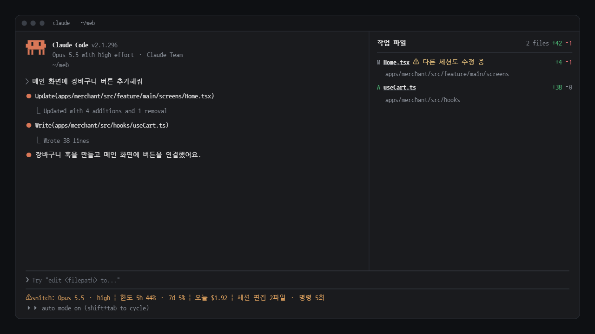
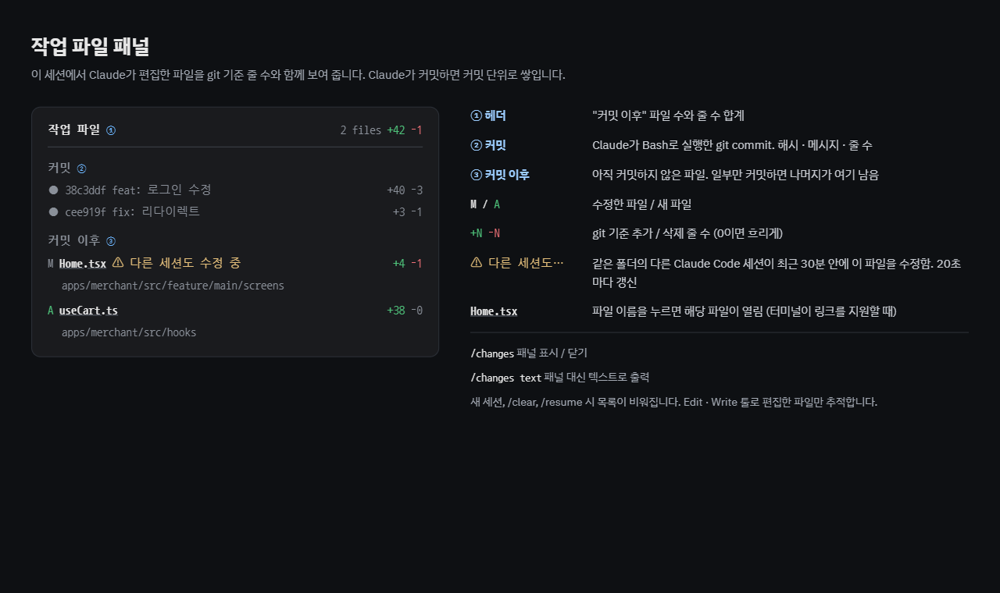
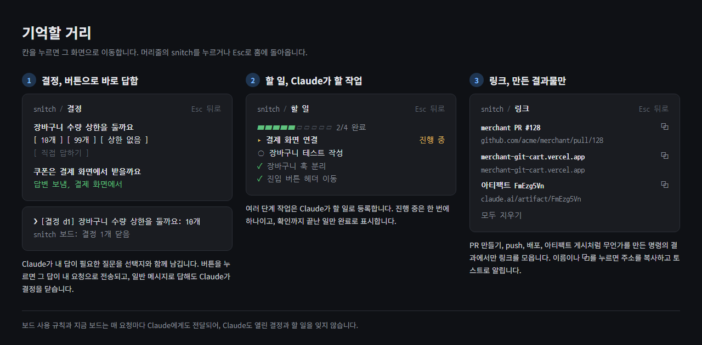
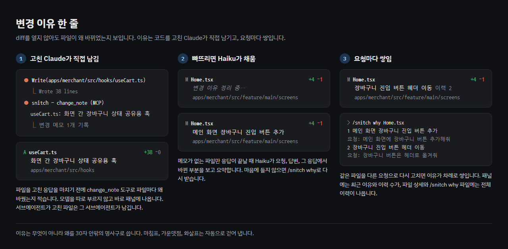
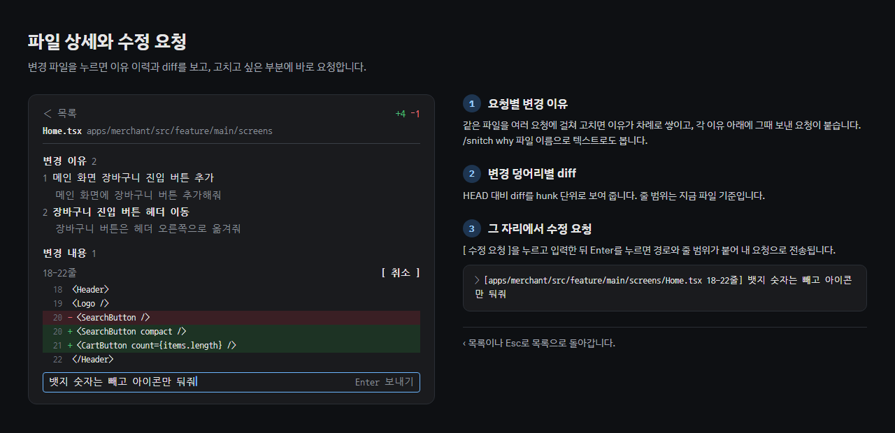
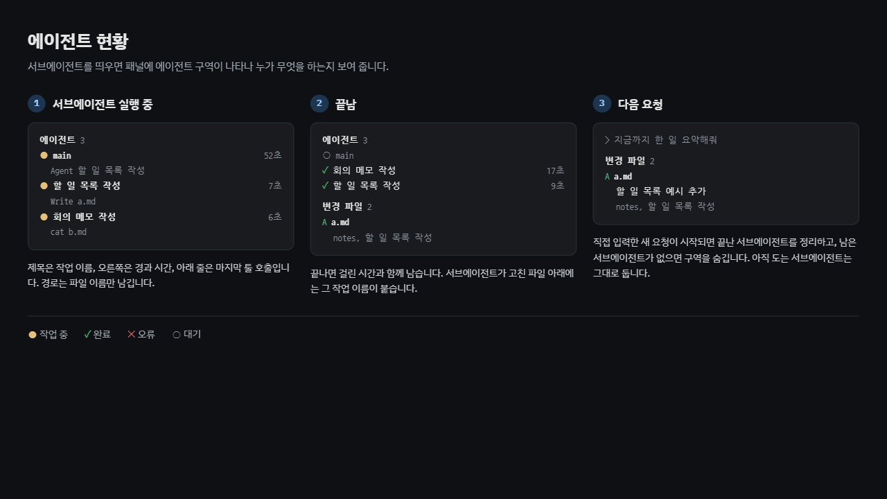
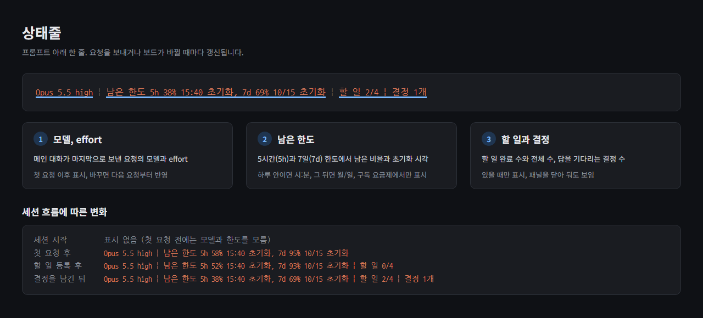

# snitch

[한국어](README.md) | English

A Claude Code mod that keeps snitching on what Claude does, right beside the conversation.



- **What changed and why**: a one-line reason for every changed file, the reasons per request, and the file's diff with an edit request right there
- **What is left**: decisions you need to make, todos, and links Claude created, pinned to the top of the pane
- **Where things stand**: subagents, remaining usage limits with reset times, and a warning when another session edits the same file

Requirements: Claude Code v2.1.287 or later (CLI, Code tab in the desktop app), macOS, Linux, Windows

> The screenshots and the panel itself are in Korean. UI labels are translated in this README.

## Install

In Claude Code, add the marketplace and install the plugin.

```
/plugin marketplace add yuntaengtaeng/snitch
/plugin install snitch@snitch
```

From a terminal, you can install it in one line.

```
claude plugin install snitch --marketplace yuntaengtaeng/snitch
```

Restart Claude Code after installing.

## Quick start

Open Claude Code in a git repository and work as usual. In the fullscreen layout the pane opens on the right by itself; otherwise open it with `/snitch`.



From the top, the pane shows things to remember, agents, changed files and commits. Empty sections are hidden. Where the pane sits for each screen mode and terminal width is described in [How it works](docs/how-it-works.md#패널-위치) (Korean).

## Features

### Things to remember



Decisions, todos and links stay pinned to the top of the pane so they don't scroll away.

- **Decisions** (결정 필요): questions Claude needs you to answer. Press an option button or **Answer myself** (직접 답하기); your answer is sent as your prompt and Claude closes the decision.
- **Todos** (할 일): multi-step work Claude registers, with the item in progress and the done count.
- **Links** (링크): only links to things Claude made in this session, such as PRs, deploy URLs and artifacts.

The board is also passed to Claude on every request, so Claude doesn't forget open decisions and todos either.

### Changed files and reasons



Files Claude changed in this session, with git line counts and a one-line reason why each changed.

- The Claude that edited the code leaves the reason itself with the `change_note` tool. Only files it missed are summarized by Haiku when the reply ends.
- When a file is changed across several requests, the reasons stack up per request; the pane shows the latest one and `이력 N` (N in history).
- When Claude commits, the files move to the commits section.
- `⚠ 다른 세션도 수정 중` (another session is editing) appears when another Claude Code session in the same folder changed the file within the last 30 minutes.

### File detail and edit requests



Press a changed file to see its reason history and its diff hunk by hunk. Press **Edit request** (수정 요청), write something like "keep the old approach here", and `[src/auth/login.ts 10-13줄] keep the old approach here` is sent as your prompt. Esc goes back to the list.

### Agents



When subagents run, each shows its task name, state (`●` working, `✓` done, `✕` error), elapsed time and last tool call. Finished subagents leave the list on your next request.

### Status line



```
Opus 5.5 high  |  남은 한도 5h 38% 15:40 초기화, 7d 69% 10/15 초기화
```

The main conversation's model and effort, and the remaining plan limits (남은 한도) with their reset times (초기화), on one line below the prompt. Limits appear on subscription plans only.

## Commands

| Command | Action |
|---|---|
| `/snitch` | Open or close the dashboard pane |
| `/snitch text` | Print it as text instead of the pane |
| `/snitch why` | Summarize the reasons of uncommitted files again |
| `/snitch why <file>` | Print the per-request reason history of a file |

`/changes` is an alias of `/snitch`.

## Configuration

Edit `hooks/config.ts`. The common ones are below; the rest are documented in the file.

| Setting | Default | Description |
|---|---|---|
| `ENABLE.statusLine` | `true` | Status line |
| `ENABLE.workFiles` | `true` | Dashboard pane |
| `ENABLE.board` | `true` | Things-to-remember board |
| `ENABLE.changeNotes` | `true` | Reasons left by Claude itself |
| `ENABLE.changeReasons` | `true` | Haiku summaries for files without a note |
| `PANE_AUTO_OPEN` | `true` | Open the pane by itself in the fullscreen layout |
| `PANE_DOCK_COLUMNS` | `56` | Width of the side pane |
| `PANE_FILE_LINKS` | `false` | Show the file name in the file detail as a file:// link |
| `REASON_MODEL` | `'haiku'` | Model that summarizes reasons |

## Permissions and data

Mods run without a sandbox, with the same permissions as Claude Code.

| Permission | Used for |
|---|---|
| Running `git` | Reading changes and diffs (`diff`, `show`, `log`, `rev-parse`, `ls-files`), saving the comparison point for Haiku summaries (`hash-object -w`, unreferenced objects cleaned up by git gc) |
| Reading files | Line counts and contents of new files |
| Registering tools | The `change_note` and `board` tools with their instructions, and the current board, added to the system prompt |
| Sending prompts | Decision answers and edit requests, only when you press a button or submit an input |
| Sending a reply back | Once, when Claude ends on a question without recording a decision |
| Calling a model | Summarizing reasons for files without a note (`REASON_MODEL`, counts toward your plan limits) |
| Plugin storage | Per-file edit times for the other-session warning (deleted after 60 minutes) |

For Haiku summaries, your request, Claude's reply and the diffs of changed files are sent to the model through Claude Code. There is no other network access.

## Limitations

- Only files Claude changed with Edit, Write, MultiEdit, NotebookEdit or Bash are tracked. Files you edit yourself are not included.
- Only `git commit` run by Claude appears in the commits section. Files you commit yourself leave the changed files once they match HEAD.
- Decisions and todos are recorded by Claude through a tool, so anything the model misses won't appear on the board.
- The reason history and the board live for the session only and are cleared on `/clear` and `/resume`.
- The dashboard pane doesn't work outside a git repository.
- The other-session warning only works between sessions on the same machine and folder.
- While the prompt has focus, the first press on a pane button may take two clicks.
- If a link shows as `name https://...`, cut off, and opens a truncated address, Claude Code didn't detect hyperlink support in your terminal. Set `FORCE_HYPERLINK=1` before starting Claude Code (seen in Git Bash inside VS Code on Windows).
- The mods API is in early access, so behavior may change with Claude Code updates.

## Development

```
claude plugin validate .
claude plugin test .
claude --plugin-dir .
```

Claude Code generates the `'claude-code'` types in `.claude-plugin/types/` when it loads a mod. After cloning, run `claude --plugin-dir .` once and the editor's type errors go away. In Git Bash, `scripts/try.sh` starts snitch in a clean test repository; scenarios to check are in [docs/testing.md](docs/testing.md) (Korean). Internals are described in [docs/how-it-works.md](docs/how-it-works.md) (Korean).

## Credits

- [pinboard](https://github.com/sirkitree/pinboard) (MIT): the board tool's working rules, the Stop hook that turns a trailing question into a decision, and the link capture rules

## License

[MIT](LICENSE)
