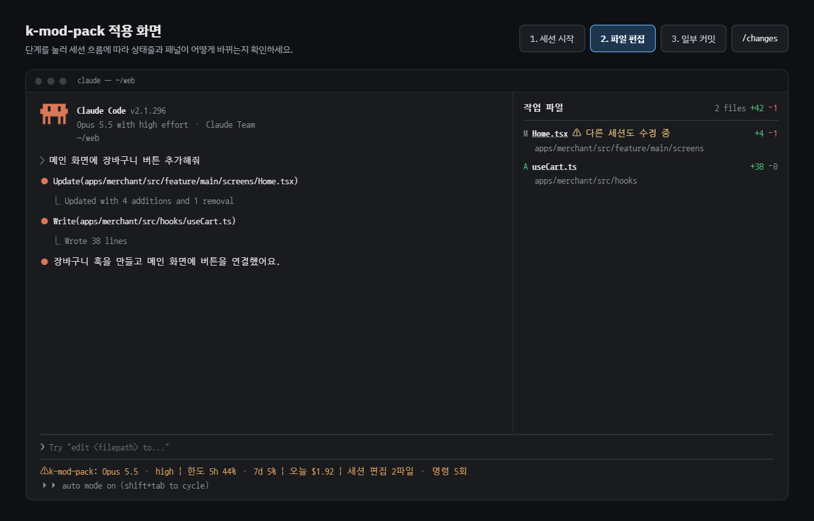

# snitch

Claude가 한 일을 전부 일러바치는 Claude Code mod입니다. 무슨 파일을 고쳤는지, 커밋은 했는지, 오늘 얼마를 썼는지, 다른 세션이 같은 파일을 건드리는지 옆에서 계속 알려 줍니다.



- **요구 사항**: Claude Code v2.1.287 이상 (CLI, 데스크톱 앱 Code 탭)
- **지원 OS**: macOS, Linux, Windows

## 설치

Claude Code에서 실행합니다.

```
/plugin install snitch --marketplace <GITHUB_ID>/snitch
```

설치 후 Claude Code를 다시 시작하면 적용됩니다.

## 기능

### 상태줄


프롬프트 아래에 한 줄로 표시됩니다.

```
Opus 5.5 · high  |  한도 5h 62% · 7d 31%  |  오늘 $4.80  |  세션 편집 7파일 · 명령 23회
```

| 항목 | 설명 |
|---|---|
| 모델 · effort | 메인 대화가 마지막으로 보낸 요청의 모델과 effort |
| 한도 | 요금제 사용 한도(5시간, 7일)의 사용률 |
| 오늘 | 오늘(로컬 자정 기준) 실행한 모든 세션의 비용 합계 |
| 세션 | 현재 세션에서 Claude가 편집한 파일 수와 실행한 명령 수 |

- 모델 · effort는 첫 요청 이후에 표시되며, 변경 사항은 다음 요청부터 반영됩니다.
- 한도는 구독 요금제에서만 표시됩니다.
- 구독 요금제의 비용은 API 가격 기준 환산액일 수 있습니다.

### 작업 파일 패널


현재 세션에서 Claude가 편집한 파일을 git 기준 변경 줄 수와 함께 표시합니다. Claude가 커밋하면 커밋 단위로 누적됩니다.

```
작업 파일                               2 files  +42 −1
──────────────────────────────────────────────────────

커밋
● 38c3ddf feat: 로그인 수정                      +40 −3
● cee919f fix: 리다이렉트                         +3 −1

커밋 이후
M Home.tsx  ⚠ 다른 세션도 수정 중                  +4 −1
  apps/merchant/src/feature/main/screens
A useCart.ts                                    +38 −0
  apps/merchant/src/hooks
```

| 표시 | 의미 |
|---|---|
| `M` / `A` | 수정한 파일 / 새 파일 (파일 이름을 누르면 해당 파일이 열림) |
| `+N −N` | git 기준 추가 / 삭제 줄 수 |
| `⚠ 다른 세션도 수정 중` | 같은 폴더의 다른 Claude Code 세션이 최근 30분 안에 이 파일을 수정함 |

| 명령 | 동작 |
|---|---|
| `/changes` | 패널 표시 / 닫기 |
| `/changes text` | 패널 대신 텍스트로 출력 |

**패널 위치**


| 화면 모드 | 위치 |
|---|---|
| 전체화면 레이아웃, 110칸 이상 | 대화 우측 사이드바 |
| 전체화면 레이아웃, 110칸 미만 | 텍스트로 출력 |
| 일반 화면 (`CLAUDE_CODE_NO_FLICKER=0`, tmux 기본값) | 입력창 위 |

**동작 규칙**

- 전체화면 레이아웃에서는 세션 시작 시 패널이 자동으로 열립니다. 터미널이 144칸 미만이면 숨겨진 상태로 열리며, `/changes`로 표시할 수 있습니다.
- 새 세션, `/clear`, `/resume` 시 목록이 초기화됩니다.
- 일부 파일만 커밋하면 나머지 파일은 "커밋 이후"에 남습니다.
- 다른 세션 표시는 패널이 열려 있는 동안 20초마다 갱신됩니다. 해당 세션이 그 파일을 커밋하면 표시가 사라집니다.
- 색상은 Claude Code 테마를 따릅니다. 패널 배경은 터미널·앱 테마의 배경색이며, `PANE_BACKGROUND`로 고정할 수 있습니다.
- 레포 전체 변경 내용은 Claude Code 기본 명령 `/diff`로 확인할 수 있습니다.

## 개발

저장소를 클론한 폴더에서 실행합니다.

```
claude plugin validate .
```

**고친 내용을 바로 확인 (설치 없이 한 세션에서 사용)**

```
claude --plugin-dir .
```

## 권한

mod는 샌드박스 없이 Claude Code와 같은 권한으로 실행됩니다. 이 플러그인이 사용하는 권한은 다음과 같습니다.

| 권한 | 용도 |
|---|---|
| `git` 실행 (읽기 전용) | `diff`, `show`, `log`, `rev-parse`, `ls-files` |
| 파일 읽기 | 새 파일의 줄 수 계산 |
| 플러그인 저장소 | 날짜별 비용 기록 (7일 후 자동 삭제), 파일별 수정 시각 기록 (60분 후 자동 삭제) |

네트워크 접근은 하지 않습니다.

## 설정

`hooks/config.ts`

| 설정 | 기본값 | 설명 |
|---|---|---|
| `ENABLE.statusLine` | `true` | 상태줄 표시 |
| `ENABLE.modelEffort` | `true` | 상태줄에 모델 · effort 표시 |
| `ENABLE.workFiles` | `true` | 작업 파일 패널 |
| `PANE_AUTO_OPEN` | `true` | 전체화면에서 패널 자동 열기 |
| `PANE_DOCK_COLUMNS` | `56` | 우측 패널 요청 너비 |
| `PANE_MIN_COLUMNS` | `110` | 전체화면에서 패널을 표시할 최소 너비 |
| `PANE_BACKGROUND` | `null` | 패널 배경색 (`null`이면 테마를 따름) |
| `CONFLICT_TTL_MIN` | `30` | 다른 세션의 수정을 유효하다고 볼 시간(분) |
| `CONFLICT_POLL_SEC` | `20` | 다른 세션 수정 기록 확인 주기(초) |
| `COST_KEEP_DAYS` | `7` | 비용 기록 보관 기간 |

## 제한 사항

- 작업 파일은 Edit, Write, MultiEdit, NotebookEdit 툴로 편집한 파일만 추적합니다. Bash로 변경한 파일과 사용자가 직접 편집한 파일은 포함되지 않습니다.
- 커밋은 Claude가 Bash로 실행한 `git commit`만 감지합니다.
- git 저장소가 아닌 폴더에서는 작업 파일 패널이 동작하지 않습니다.
- 다른 세션 표시는 같은 PC, 같은 폴더의 세션끼리만 동작합니다. git worktree로 나눈 폴더나 다른 PC의 세션은 감지하지 않습니다.
- mod API는 초기 단계로, Claude Code 업데이트에 따라 동작이 달라질 수 있습니다.
