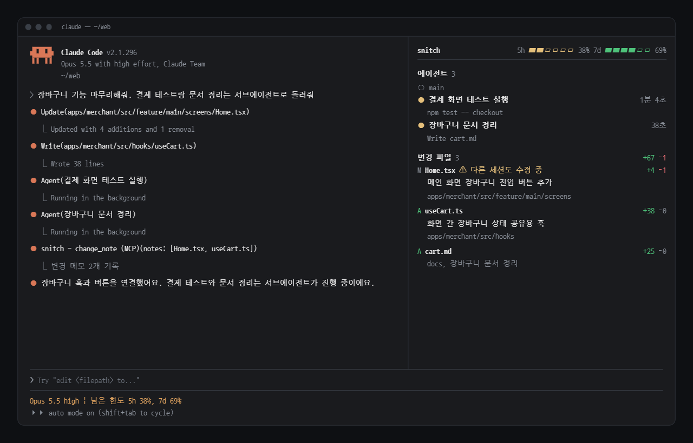
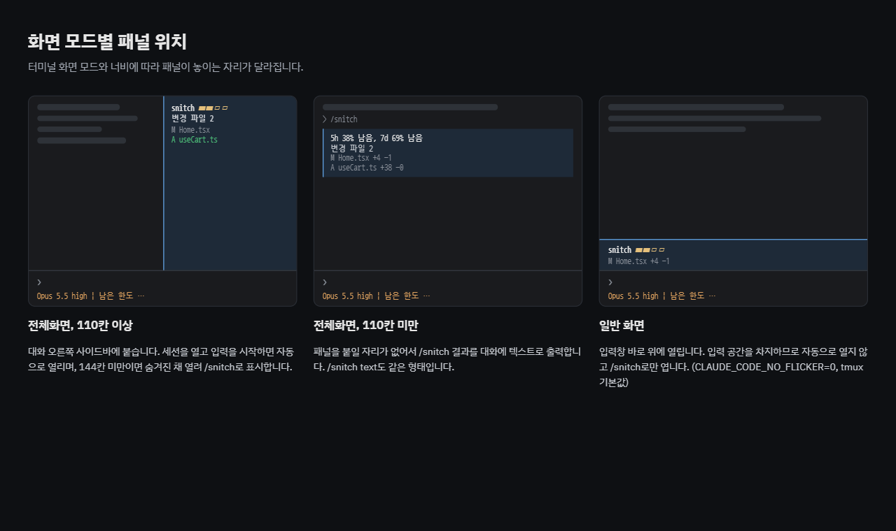

# snitch

한국어 | [English](README.en.md)

Claude가 한 일을 전부 일러바치는 Claude Code mod입니다. 무슨 파일을 왜 고쳤는지, 서브에이전트가 무엇을 하고 있는지, 커밋은 했는지, 다른 세션이 같은 파일을 건드리는지 옆에서 계속 알려 줍니다.




- **요구 사항**: Claude Code v2.1.287 이상 (CLI, 데스크톱 앱 Code 탭)
- **지원 OS**: macOS, Linux, Windows

## 설치

Claude Code에서 마켓플레이스를 추가한 뒤 설치합니다.

```
/plugin marketplace add yuntaengtaeng/snitch
/plugin install snitch@snitch
```

터미널에서는 한 줄로 설치할 수 있습니다.

```
claude plugin install snitch --marketplace yuntaengtaeng/snitch
```

설치 후 Claude Code를 다시 시작하면 적용됩니다.

## 기능

### 상태줄


프롬프트 아래에 한 줄로 표시됩니다.

```
Opus 5.5 high  |  남은 한도 5h 38%, 7d 69%
```

| 항목 | 설명 |
|---|---|
| 모델, effort | 메인 대화가 마지막으로 보낸 요청의 모델과 effort |
| 남은 한도 | 요금제 사용 한도(5시간, 7일)에서 남은 비율, 대시보드 제목 줄 막대와 같은 값 |

- 모델과 effort는 첫 요청 이후에 표시되며, 변경 사항은 다음 요청부터 반영됩니다.
- 한도는 구독 요금제에서만 표시됩니다.
- 편집한 파일은 대시보드 패널에서 확인합니다.

### 대시보드 패널


에이전트 현황과 현재 세션에서 Claude가 편집한 파일을 한 패널에 표시합니다. 파일은 git 기준 변경 줄 수, 변경 이유 한 줄과 함께 나오며, Claude가 커밋하면 커밋 구역으로 옮겨 갑니다.

```
snitch              5h ▰▰▱▱▱▱ 38%  7d ▰▰▰▰▱▱ 69%
──────────────────────────────────────────────────

에이전트 3
● main                                     1분 12초
  Agent 장바구니 훅 작성
● 장바구니 훅 작성                              40초
  Write useCart.ts
✓ 헤더 컴포넌트 찾기                             12초

변경 파일 2                                +42 −1
M Home.tsx  ⚠ 다른 세션도 수정 중              +4 −1
  장바구니 버튼 헤더 이동
  apps/merchant/src/feature/main/screens
A useCart.ts                                +38 −0
  화면 간 장바구니 상태 공유용 훅
  apps/merchant/src/hooks, 장바구니 훅 작성

커밋 2
● 38c3ddf feat: 로그인 수정                  +40 −3
● cee919f fix: 리다이렉트                     +3 −1
```

| 표시 | 의미 |
|---|---|
| 제목 줄 막대 | 요금제 남은 한도 (5시간, 7일), 초록 넉넉함, 노랑 절반 아래, 빨강 20% 아래 |
| 에이전트 아이콘 | `●` 작업 중, `✓` 완료, `✕` 오류, `○` 대기 |
| 에이전트 이름 | 서브에이전트는 작업 이름, 메인 대화는 `main` |
| 오른쪽 시간 | 작업 중이면 경과 시간, 끝났으면 걸린 시간 |
| 에이전트 아래 줄 | 작업 중일 때 마지막 툴 호출 (경로는 파일 이름만) |
| `M` / `A` | 수정한 파일 / 새 파일 (`PANE_FILE_LINKS`를 켜면 파일 이름을 눌러 열 수 있음) |
| `+N −N` | git 기준 추가 / 삭제 줄 수 |
| 파일 아래 첫 줄 | 변경 이유 한 줄 (아래 참고) |
| 파일 아래 마지막 줄 | 폴더, 서브에이전트가 고쳤으면 그 작업 이름 |
| `⚠ 다른 세션도 수정 중` | 같은 폴더의 다른 Claude Code 세션이 최근 30분 안에 이 파일을 수정함 |

| 명령 | 동작 |
|---|---|
| `/snitch` | 대시보드 패널 표시 / 닫기 |
| `/snitch text` | 패널 대신 텍스트로 출력 |
| `/snitch why` | 아직 커밋하지 않은 파일의 변경 이유 다시 요약 |

`/changes`도 같은 동작을 하는 별칭입니다.

**에이전트**


- 에이전트 구역은 서브에이전트가 있을 때만 보입니다.
- `main`은 메인 대화이며, Claude가 응답하는 동안 작업 중, 응답이 끝나면 대기로 표시됩니다.
- 서브에이전트는 시작하면 작업 중, 끝나면 완료(실패, 중단은 오류)로 바뀝니다. 끝난 서브에이전트는 다음 요청을 입력할 때 목록에서 빠집니다.
- 작업 중인 에이전트가 있으면 5초마다 경과 시간을 갱신하고 Claude Code의 에이전트 목록과 상태를 맞춥니다.
- 데이터는 현재 세션의 이벤트(서브에이전트 시작, 툴 호출, 턴 종료)에서만 가져옵니다. 다른 세션의 에이전트는 표시하지 않습니다.

**변경 이유**


변경 이유는 **코드를 고친 Claude가 직접** 남깁니다. snitch가 `change_note` 도구를 등록하고, Claude는 파일을 고친 응답을 마치기 전에 이 도구로 파일마다 "무엇을"이 아니라 "왜"를 30자 안팎의 명사구로 적습니다 (예: `화면 간 장바구니 상태 공유용 훅`). 서브에이전트가 고친 파일은 그 서브에이전트가 남깁니다.

- 대화에 `change_note` 도구 호출이 한 줄 보이며, 그 내용이 그대로 패널에 나옵니다.
- Claude가 메모를 빠뜨린 파일만, 응답이 끝날 때 Haiku가 사용자 요청, Claude의 마지막 답변, diff를 보고 한 번에 요약합니다. 요약하는 동안에는 `변경 이유 정리 중…`으로 표시됩니다.
- 같은 파일을 다음 턴에 다시 고치면 이유가 새로 바뀝니다.
- 이유가 비었거나 마음에 들지 않으면 `/snitch why`로 Haiku 요약을 다시 받을 수 있습니다.
- `ENABLE.changeNotes`로 작성자 메모를, `ENABLE.changeReasons`로 Haiku 요약을 각각 끌 수 있습니다.

**패널 위치**



| 화면 모드 | 위치 |
|---|---|
| 전체화면 레이아웃, 110칸 이상 | 대화 우측 사이드바 |
| 전체화면 레이아웃, 110칸 미만 | 텍스트로 출력 |
| 일반 화면 (`CLAUDE_CODE_NO_FLICKER=0`, tmux 기본값) | 입력창 위 |

**동작 규칙**

- 전체화면 레이아웃에서는 패널이 자동으로 열립니다. 세션을 막 열었을 때는 입력을 시작하면 나타납니다. 터미널이 144칸 미만이면 숨겨진 채 열리며, `/snitch`로 표시할 수 있습니다.
- 새 세션, `/clear`, `/resume` 시 목록이 초기화됩니다.
- 일부 파일만 커밋하면 나머지 파일은 "커밋 이후"에 남습니다.
- 다른 세션 표시는 패널이 열려 있는 동안 20초마다 갱신됩니다. 해당 세션이 그 파일을 커밋하면 표시가 사라집니다.
- 색상은 Claude Code 테마를 따릅니다. 패널 배경은 터미널·앱 테마의 배경색이며, `PANE_BACKGROUND`로 고정할 수 있습니다.
- 레포 전체 변경 내용은 Claude Code 기본 명령 `/diff`로 확인할 수 있습니다.

## 개발

저장소를 클론한 폴더에서 실행합니다.

```
claude plugin validate .
claude plugin test .
```

**직접 시험**

Git Bash에서 `scripts/try.sh`를 실행하면 `~/snitch-test`에 깨끗한 시험 저장소를 만들고 그 안에서 snitch를 띄웁니다. 확인할 시나리오는 [docs/testing.md](docs/testing.md)에 있습니다.

**고친 내용을 바로 확인 (설치 없이 한 세션에서 사용)**

```
claude --plugin-dir .
```

`'claude-code'` 타입은 Claude Code가 mod를 로드할 때 `.claude-plugin/types/`에 생성합니다. 클론한 뒤 위 명령으로 한 번 실행하면 에디터의 타입 오류가 사라집니다.

## 권한

mod는 샌드박스 없이 Claude Code와 같은 권한으로 실행됩니다. 이 플러그인이 사용하는 권한은 다음과 같습니다.

| 권한 | 용도 |
|---|---|
| `git` 실행 (읽기 전용) | `diff`, `show`, `log`, `rev-parse`, `ls-files` |
| 파일 읽기 | 새 파일의 줄 수 계산, 변경 이유 요약에 넣을 새 파일 내용 |
| 도구 등록 | `change_note` 도구와 그 사용 안내를 시스템 프롬프트에 추가 |
| 모델 호출 | 메모가 없는 파일의 변경 이유 요약 (`REASON_MODEL`) |
| 플러그인 저장소 | 파일별 수정 시각 기록 (60분 후 자동 삭제) |

Haiku로 변경 이유를 요약할 때 사용자 요청, Claude의 답변, 변경된 파일의 diff가 Claude Code를 통해 모델로 전송됩니다. 그 밖의 네트워크 접근은 하지 않습니다.

이 요약 호출은 Claude Code 사용량(요금제 한도)에 포함됩니다. Claude가 `change_note`로 메모를 남긴 파일은 요약하지 않으므로 메모가 빠진 경우에만 호출하며, `ENABLE.changeReasons`를 끄면 호출하지 않습니다.

## 설정

`hooks/config.ts`

| 설정 | 기본값 | 설명 |
|---|---|---|
| `ENABLE.statusLine` | `true` | 상태줄 표시 |
| `ENABLE.modelEffort` | `true` | 상태줄에 모델과 effort 표시 |
| `ENABLE.workFiles` | `true` | 대시보드 패널 |
| `ENABLE.changeNotes` | `true` | Claude가 `change_note` 도구로 직접 남기는 변경 이유 |
| `ENABLE.changeReasons` | `true` | 메모가 없는 파일의 변경 이유를 Haiku로 요약 |
| `PANE_AUTO_OPEN` | `true` | 전체화면에서 패널 자동 열기 |
| `PANE_DOCK_COLUMNS` | `56` | 우측 패널 요청 너비 |
| `PANE_FILE_LINKS` | `false` | 파일 이름을 file:// 링크로 표시 (링크를 지원하지 않는 터미널에서는 주소가 그대로 보임) |
| `PANE_MAX_ROWS` | `30` | 패널을 열 때 요청하는 최대 높이(줄) |
| `LIMIT_BAR_SEGMENTS` | `6` | 제목 줄 한도 막대 칸 수 |
| `AGENT_TICK_SEC` | `5` | 에이전트 상태 확인 주기(초) |
| `PANE_MIN_COLUMNS` | `110` | 전체화면에서 패널을 표시할 최소 너비 |
| `PANE_BACKGROUND` | `null` | 패널 배경색 (`null`이면 테마를 따름) |
| `CONFLICT_TTL_MIN` | `30` | 다른 세션의 수정을 유효하다고 볼 시간(분) |
| `CONFLICT_POLL_SEC` | `20` | 다른 세션 수정 기록 확인 주기(초) |
| `REASON_MODEL` | `'haiku'` | 변경 이유를 요약할 모델 |
| `REASON_DIFF_CHARS` | `12000` | 요약 요청에 넣을 diff 최대 글자 수 |
| `REASON_MAX_CHARS` | `30` | 변경 이유 한 줄의 최대 글자 수 |
| `REASON_TIMEOUT_SEC` | `30` | 요약 요청 제한 시간(초) |

## 제한 사항

- 작업 파일은 Edit, Write, MultiEdit, NotebookEdit 툴로 편집한 파일과, Claude Code가 Bash 실행 결과로 알려 주는 변경 파일을 추적합니다. 사용자가 직접 편집한 파일은 포함되지 않습니다.
- 커밋은 Claude가 Bash로 실행한 `git commit`만 감지합니다.
- git 저장소가 아닌 폴더에서는 대시보드 패널이 동작하지 않습니다.
- 다른 세션 표시는 같은 PC, 같은 폴더의 세션끼리만 동작합니다. git worktree로 나눈 폴더나 다른 PC의 세션은 감지하지 않습니다.
- mod API는 초기 단계로, Claude Code 업데이트에 따라 동작이 달라질 수 있습니다.

## 라이선스

[MIT](LICENSE)
